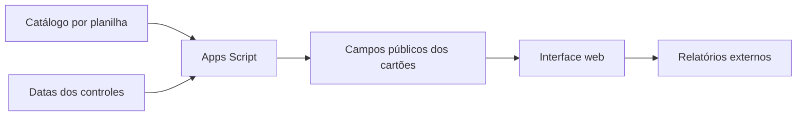

# Acesso organizado e contexto de atualização

## Necessidade

Relatórios distribuídos em diferentes locais dificultam localizar o painel desejado e entender qual é a data registrada nas bases. A central reúne esses acessos em um catálogo.

## Solução profissional

Aplicação web em Google Apps Script com HTML, CSS e JavaScript. O catálogo fica em uma planilha e o servidor consulta as colunas de datas dos controles de origem. A interface apresenta cartões e links para os relatórios do Looker Studio.

## Decisões

- Separar acesso a relatórios de atualização das bases.
- Mostrar estados Em construção e Data não disponível sem inventar datas.
- Preservar a referência de horário dos controles.
- Selecionar a maior data válida, sem presumir que está na última linha.
- Distinguir data registrada de garantia de atualização completa.
- Consultar ao abrir e por ação do usuário, sem atribuir ao botão a execução das automações.

## O que está demonstrado aqui

O catálogo e os relatórios são fictícios. As regras de datas têm testes reproduzíveis. A interface permite experimentar temas, busca, navegação e consulta. A variante Apps Script usa somente um catálogo de exemplo, sem ler qualquer planilha.

Não foram medidos ganhos de produtividade ou usabilidade. A finalidade profissional foi organizar acesso e contextualizar a leitura dos relatórios; os números mostrados na demonstração não representam resultados dessa operação.
