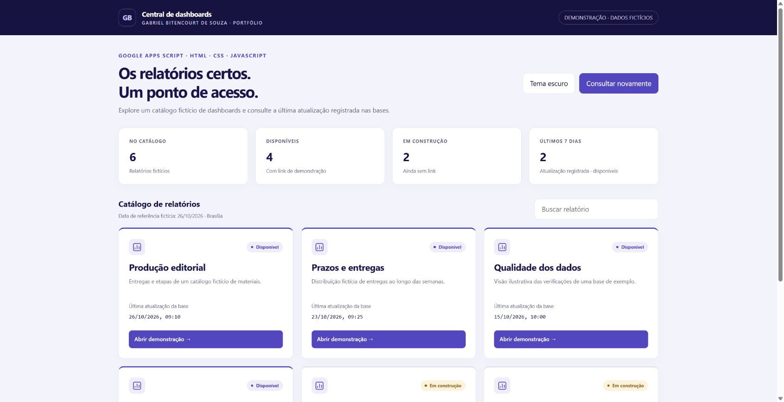

# Central de acesso a dashboards — demonstração

Um ponto de acesso para encontrar relatórios e consultar a data registrada de atualização das bases. Esta versão apresenta um **catálogo e relatórios inteiramente fictícios**.

**[Abrir demonstração interativa](https://gabrielbsouza15.github.io/dashboard-hub-demo/)** · [Estudo de caso](CASE_STUDY.md) · [Regras de datas](docs/core.js) · [Testes](test_hub.cjs)



## Funcionalidades

- Catálogo de seis relatórios fictícios, quatro disponíveis e dois em construção.
- Data de atualização registrada, ausência de data tratada explicitamente e resumo de atualizados nos últimos sete dias.
- Janela inclusiva de hoje e dos seis dias anteriores, no fuso `America/Sao_Paulo`; datas futuras não entram na contagem.
- Tema claro inicial, alternância para escuro e layout adaptável a telas menores.
- Consulta manual do catálogo de exemplo. Não há consulta periódica, importação de bases ou atualização de gráficos.
- Busca por nome/resumo, acrescentada nesta demonstração para explorar o catálogo.
- Links para relatórios ilustrativos locais, com contagens fictícias. Eles não são relatórios do Looker Studio.

## Executar

Requer somente um navegador e um servidor de arquivos estáticos. Com Python:

```bash
python -m http.server 8000 --bind 127.0.0.1 --directory docs
```

Abra `http://127.0.0.1:8000/`. O catálogo usa a referência fictícia fixa de **26/10/2026** para manter exemplos e testes reproduzíveis.

## Testes

Com Node.js 18+:

```bash
node --test test_hub.cjs
```

Os testes verificam limites da janela de sete dias, meia-noite no fuso de São Paulo, maior data fora da última linha, ausência de datas e validação dos links locais.

## Variante Google Apps Script

`apps-script/` contém um backend fictício e a interface empacotada para um projeto pessoal de teste:

1. Criar um novo projeto Apps Script de demonstração.
2. Copiar `Hub.gs` e `Index.html` para arquivos com esses nomes.
3. Se necessário, aplicar o manifesto `appsscript.json` fornecido.
4. Testar por uma implantação de demonstração separada.

O backend retorna somente o catálogo fictício e não usa Sheets, Drive, OAuth ou IDs de origem. Os botões dessa variante mostram avisos de relatório de exemplo. O pacote foi preparado e sua sintaxe conferida; não foi implantado em uma conta Google nesta preparação. A demonstração principal usa apenas os arquivos estáticos de `docs/`.

## Relação com o projeto profissional

Desenvolvi uma central web com Google Apps Script, HTML, CSS e JavaScript para reunir acesso a dashboards do Looker Studio e consultar as datas registradas de atualização das bases. O OpenAI Codex apoiou implementação, revisão e testes.

Na solução profissional, o catálogo é configurável por planilha e as datas são lidas dos controles. A página mostra apenas os campos públicos necessários; não transmite IDs das planilhas de origem. A data mais recente de um controle não garante atualização de todas as origens nem do cache de um relatório.

Esta versão foi recriada para portfólio com dados locais fictícios, identidade pessoal e código demonstrativo independente. Não inclui marcas, dados, IDs, links ou permissões de projetos profissionais. A busca e os relatórios locais pertencem à demonstração, sem atribuição de implantação no produto profissional.

## Autor

[Gabriel Bitencourt de Souza](https://www.linkedin.com/in/gabrielbitencourtdesouza/) · Dados, BI e automação · Engenharia de Produção em andamento na UFV.

Código demonstrativo preparado com apoio do OpenAI Codex, sob orientação de Gabriel. Licença MIT somente para o conteúdo deste repositório.


## Verificação automática

O workflow executa os testes de datas e links locais em Linux com Node.js 24. A execução ocorre em alterações de `main`, pull requests e acionamentos manuais. Consulte o resultado em [GitHub Actions](https://github.com/GabrielBSouza15/dashboard-hub-demo/actions/workflows/testes.yml).
